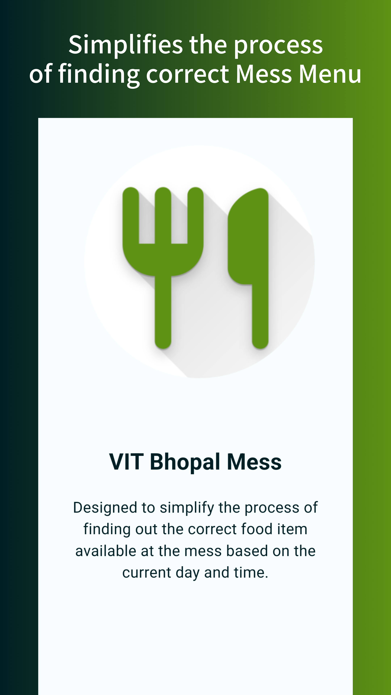
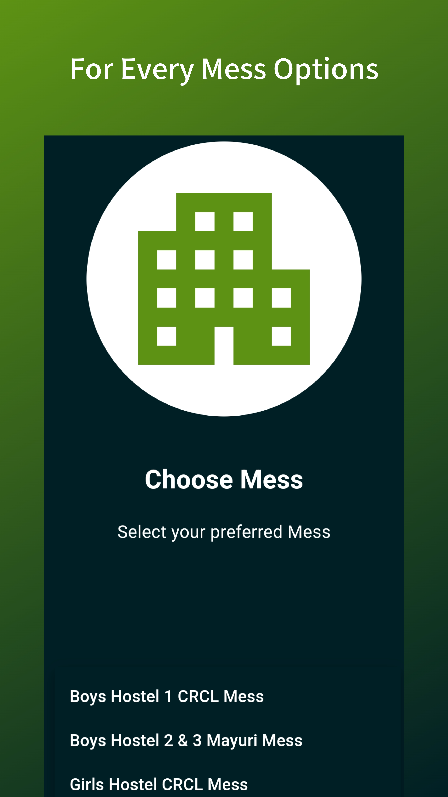
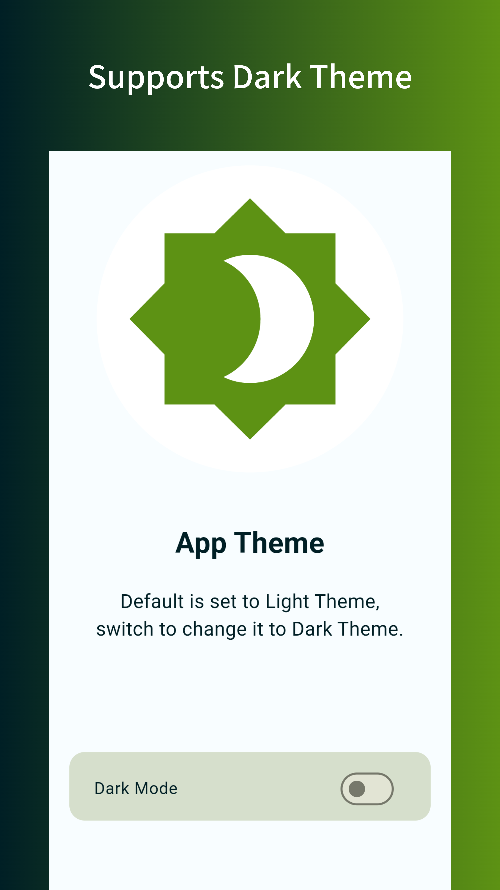
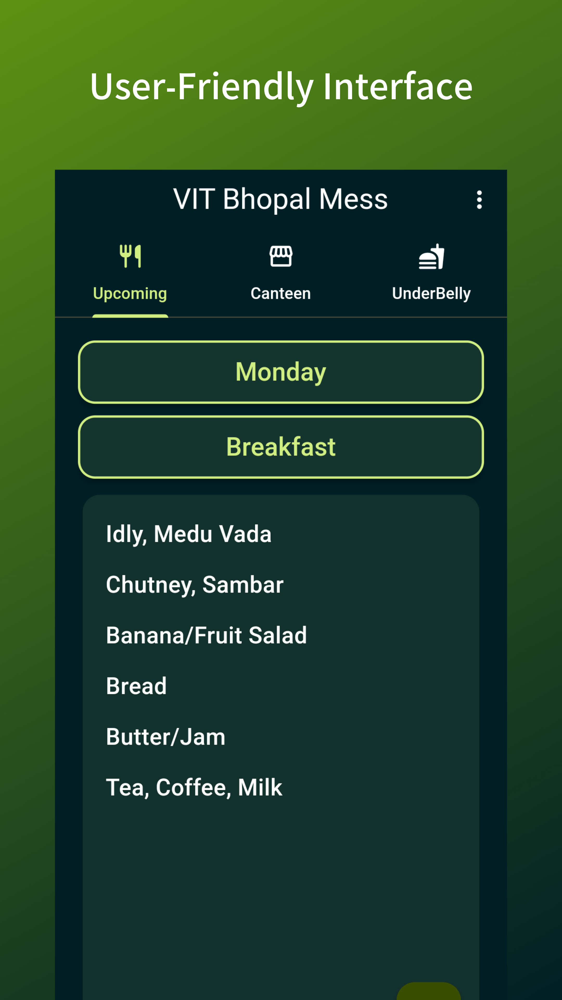
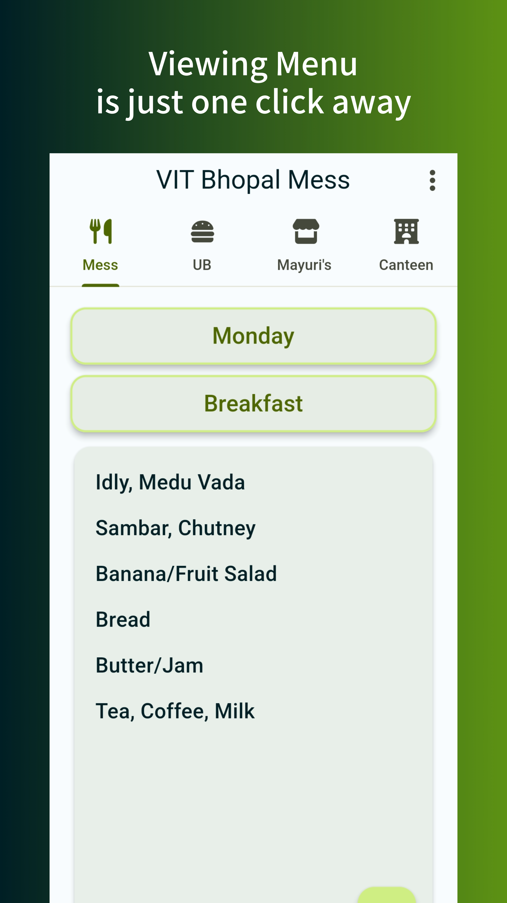
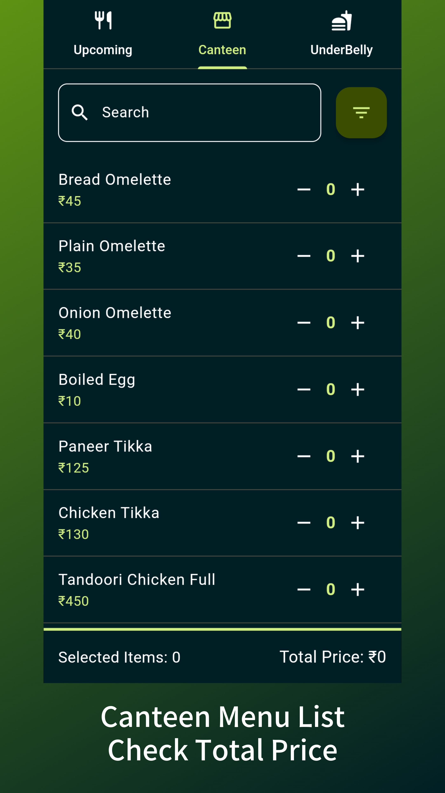
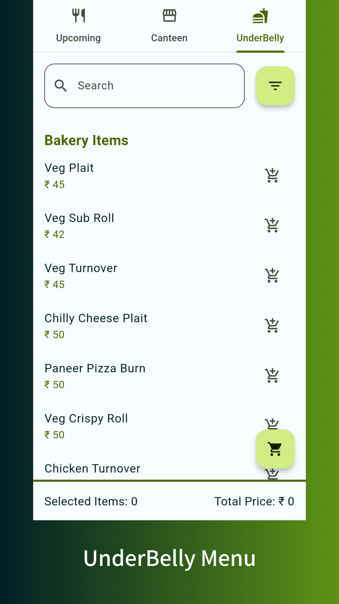
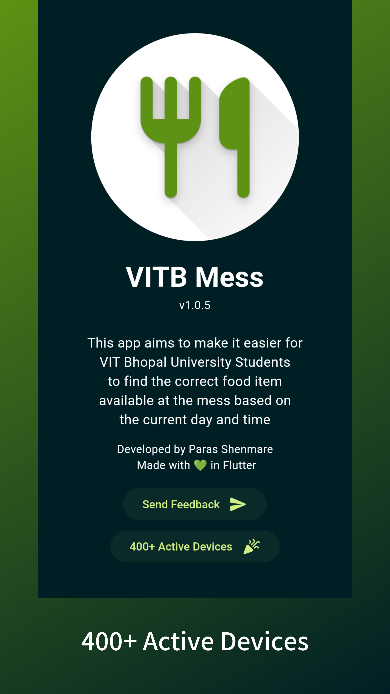

<a href='https://play.google.com/store/apps/details?id=com.shenmareparas.vit_mess&pcampaignid=pcampaignidMKT-Other-global-all-co-prtnr-py-PartBadge-Mar2515-1'></a>
 
# VIT Bhopal Mess
The "VIT Bhopal Mess" app & website is designed to simplify the process of finding out the correct food item available at the mess based on the current day and time. It provides an intuitive and user-friendly interface for VIT Bhopal University students to check the mess menu and make informed decisions about their meal choices. It also provides the option to view the menu in the Canteen as well as in UnderBelly and Mayuri with their respective prices.

Web App: [https://vitbmess.vercel.app/](https://vitbmess.vercel.app/)

<a href='https://play.google.com/store/apps/details?id=com.shenmareparas.vit_mess&pcampaignid=pcampaignidMKT-Other-global-all-co-prtnr-py-PartBadge-Mar2515-1'></a>

## Features
- **Responsive Website & Desktop UI:** Fully optimized for web and desktop browser viewports (1080p, 1440p, 4K) with max-width boundaries that prevent awkward stretching.
- **Adaptive Desktop Navigation:** Top navigation header on wide displays with centered tabs, quick 1-click caterer mess switcher dropdown, and theme toggle button.
- **Direct Day and Meal Selectors:** Single-click day (Monday to Sunday) and meal (Breakfast, Lunch, Snacks, Dinner) selectors on desktop without modal dialog popups.
- **Live Desktop Side-Cart:** Persistent order summary sidebar on desktop screens (>=1024px) for live item tracking, price calculation, item adjustments, and direct WhatsApp ordering.
- **Multi-Column Food Grids:** Responsive 1 to 4 column catalog grids with hover elevation transitions, pointer cursors, and counter controls.
- **Current Time Tracking:** The app automatically detects the current time and displays the food items available during that specific time slot.
- **User-Friendly Interface:** Upgraded with Material 3 Expressive design, featuring tonal containers, refined elevation, and responsive cards across all screens.
- **Search Functionality:** Users can search for specific dishes, days, or meal times across menus with hotkey support.
- **Canteen:** Users can view, search, and sort the canteen menu and prices, see the total price of selected items, and manage their cart.
- **UnderBelly:** Users can view, search, and jump across categories at UnderBelly with WhatsApp order dispatch and phone calling.
- **Mayuri:** Users can browse beverages, snacks, chaat, and meals served at Mayuri with instant category navigation and pricing.
- **Cart Reset Action:** Easily empty and reset the cart with a single tap and confirmation prompt inside the cart view.
- **System Default Theme Support:** Tri-state appearance options (System Default, Light Theme, Dark Theme) with automatic system brightness matching.
- **Enhanced iOS & Desktop Experience:** Native inset grouped preference sections, Cupertino toggles, selection haptics, pointer cursors, and mouse/trackpad drag scrolling via `AppScrollBehavior`.

## Screenshots
<table>
  <tr>
    <td></td>
    <td></td>
    <td></td>
  </tr>
  <tr>
    <td></td>
    <td></td>
    <td></td>
  </tr>
  <tr>
    <td></td>
    <td></td>
  </tr>
</table>

## Architecture & Technologies
- **Architecture**: Model-View-ViewModel (MVVM) pattern with `Provider`
- **Framework**: Flutter (3.50+) and Dart (3.14+) for building the cross-platform app
- **Native Dependency Management**: Swift Package Manager (SPM) for iOS (CocoaPods deintegrated)
- **Web & Desktop**: WebAssembly (WasmGC) support, responsive breakpoints, desktop mouse/trackpad drag scrolling via `AppScrollBehavior`, and OpenGraph link previews
- **Design System**: Material UI 3 Expressive with brand deep-green palettes and System Default / Light / Dark modes
- **State & Persistence**: `provider` and `shared_preferences`

## Installation
To run the "VIT Mess" app locally, follow these steps:
1. Ensure that you have Flutter installed on your machine. If not, refer to the official Flutter documentation for installation instructions.
2. Clone the repository to your local machine:
```bash
git clone https://github.com/shenmareparas/VIT_Bhopal_Mess.git
```
3. Install the dependencies for the app:
```bash
flutter pub get
```
4. Start the app:
```bash
flutter run
```
5. Or run on the web:
```bash
flutter run -d chrome
```
6. Build for high-performance WebAssembly (WasmGC):
```bash
flutter build web --wasm
```

## Contribution
Contributions to the VIT Mess app are welcome and encouraged! If you would like to contribute, please follow these steps:

1. Fork the repository.
2. Create a new branch for your feature or bug fix.
3. Make your changes and ensure that the code compiles without any errors.
4. Run `dart format .` and `flutter analyze` to ensure code quality.
5. Submit a pull request with a clear description of your changes and their benefits.

## Contact
If you have any questions, suggestions, or feedback, please feel free to contact me at shenmareparas@gmail.com or create an issue in the repository. I'd love to hear from you!

## Special Thanks
<a href = "https://github.com/addi1402"> @addi1402 </a>

## License
This project is licensed under the MIT License - see the [LICENSE](LICENSE) file for details.

## Privacy Policy
https://www.termsfeed.com/live/f3a9fb52-9e8b-45e3-a0a4-16901f7da9c4

## Enjoy using VIT Mess App!
We hope you find it helpful in determining the correct food item available at the mess. Enjoy your meal!
